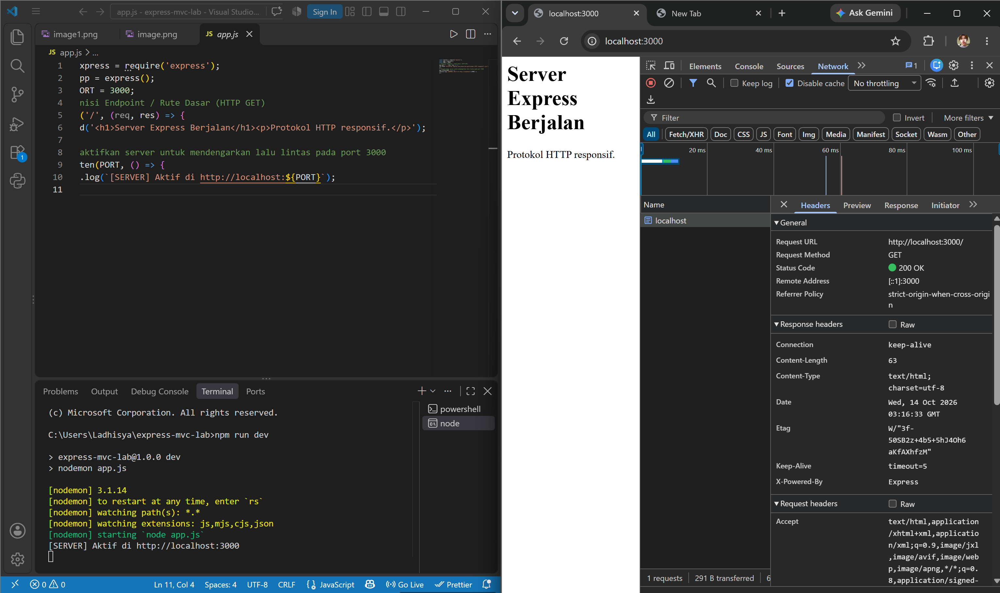
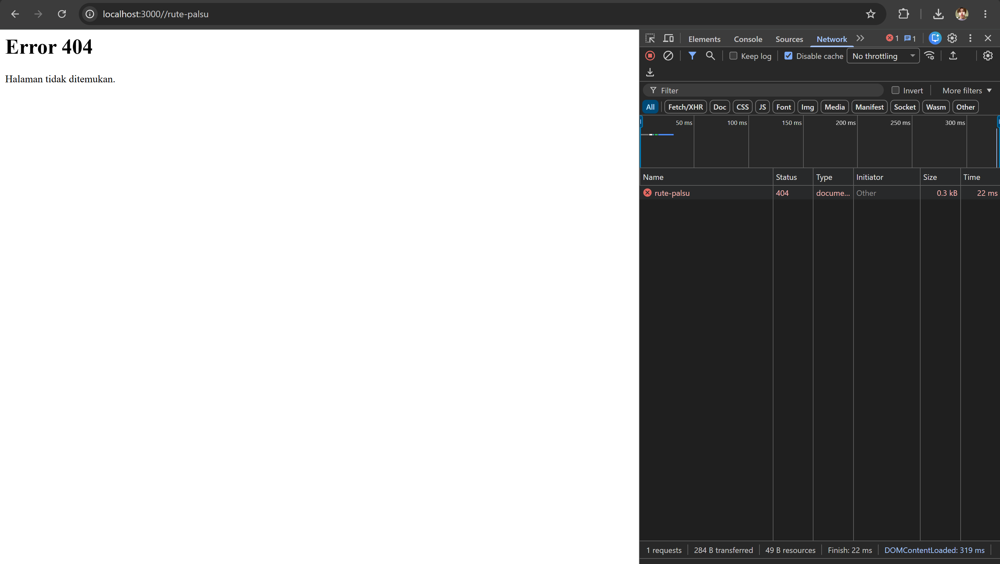
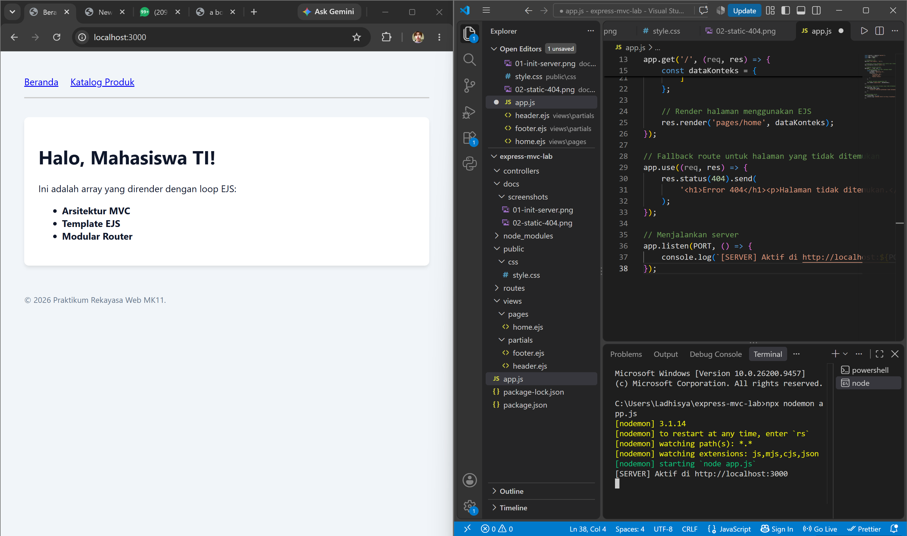
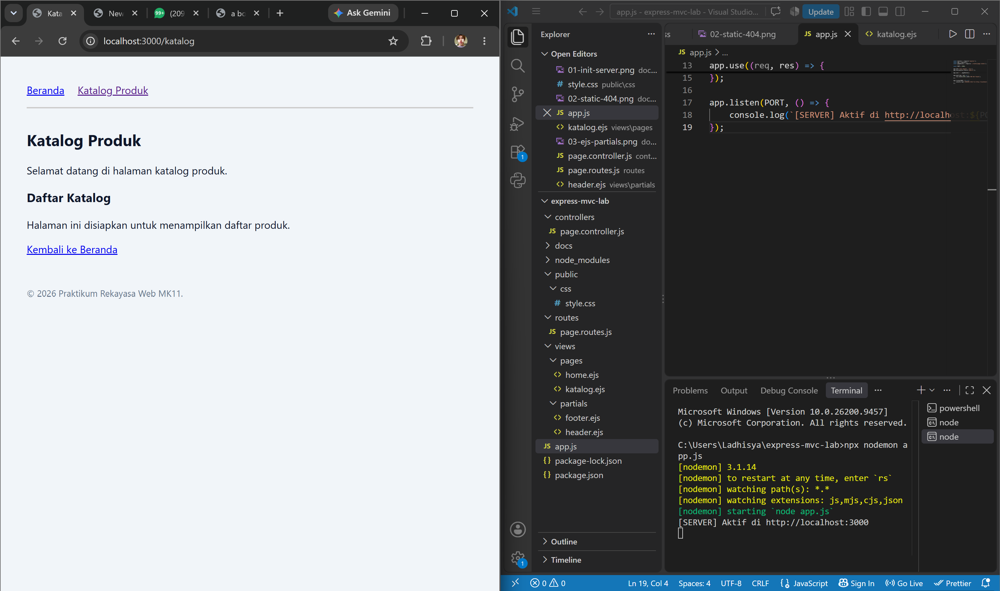
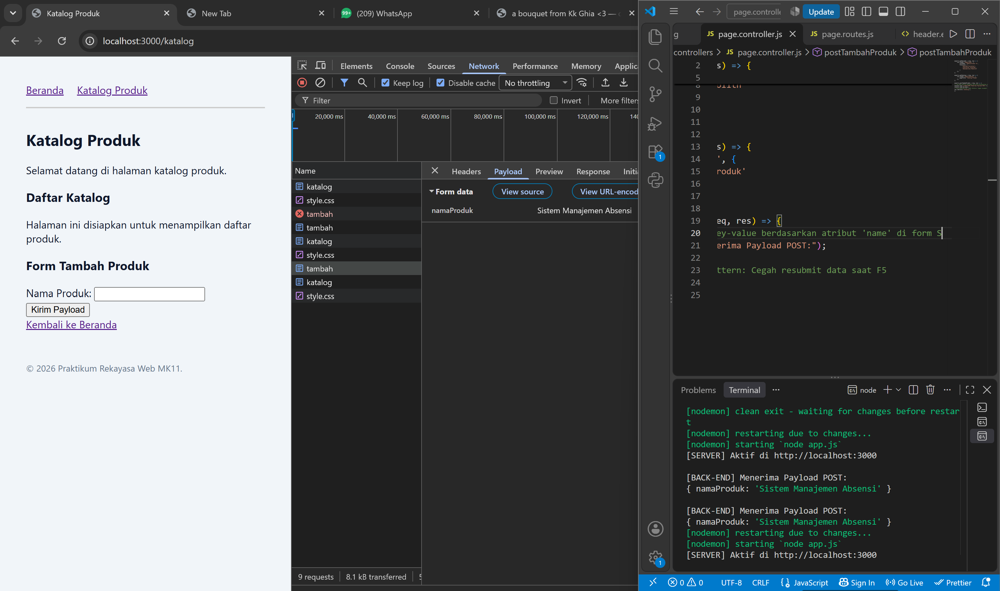
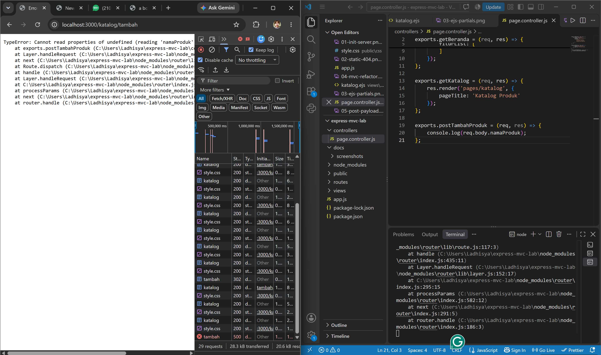
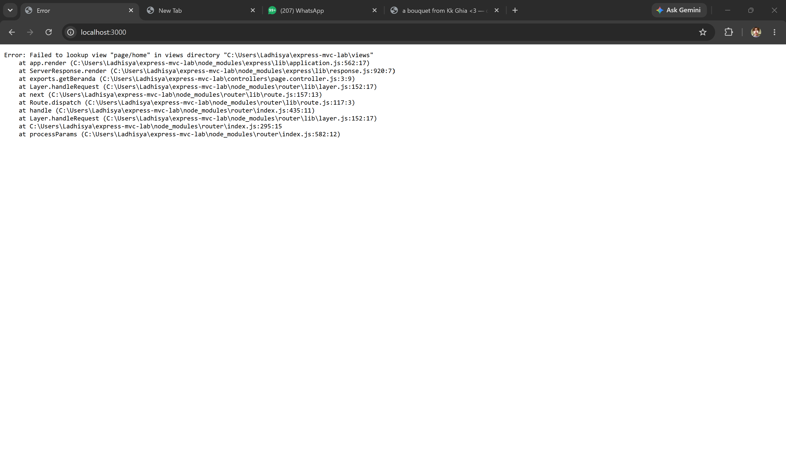
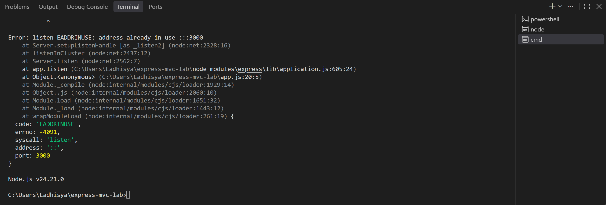

## Dokumentasi Praktikum

### 1. Inisialisasi Server Express
Screenshot ini menunjukkan proses awal pembuatan server menggunakan Express.js. Server dijalankan untuk memastikan aplikasi dapat berjalan pada port yang telah ditentukan.

### 2. Pengujian Static File dan 404
Screenshot ini menunjukkan pengujian akses halaman atau file statis. Jika alamat yang diminta tidak ditemukan, aplikasi menampilkan respons 404.

### 3. Implementasi EJS Partials
Screenshot ini menunjukkan penggunaan EJS partials untuk memisahkan bagian header dan footer agar dapat digunakan kembali pada beberapa halaman.

### 4. Refactoring ke Pola MVC
Screenshot ini menunjukkan pemisahan kode aplikasi ke dalam model struktur MVC yang digunakan pada praktikum, yaitu routes, controllers, dan views agar kode lebih terorganisasi.

### 5. Pengujian POST Payload
Screenshot ini menunjukkan pengiriman data formulir menggunakan metode POST. Data yang dikirim dapat diperiksa melalui `req.body` setelah middleware `express.urlencoded()` dipasang.

### 6. Penanganan Error Undefined
Screenshot ini mendokumentasikan error ketika data yang diakses bernilai `undefined`. Salah satu penyebabnya adalah middleware untuk membaca data formulir belum dipasang atau urutannya belum tepat.

### 7. Penanganan Error Lookup View
Screenshot ini menunjukkan error ketika Express tidak dapat menemukan file view yang diminta. Hal ini dapat terjadi jika nama file atau lokasi folder view tidak sesuai.

### 8. Penanganan Error Port
Screenshot ini menunjukkan error `EADDRINUSE`, yaitu ketika port yang ingin digunakan sudah dipakai oleh proses lain. Solusinya adalah menghentikan proses tersebut atau menggunakan port lain.

